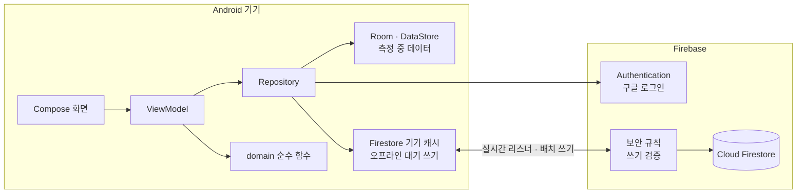
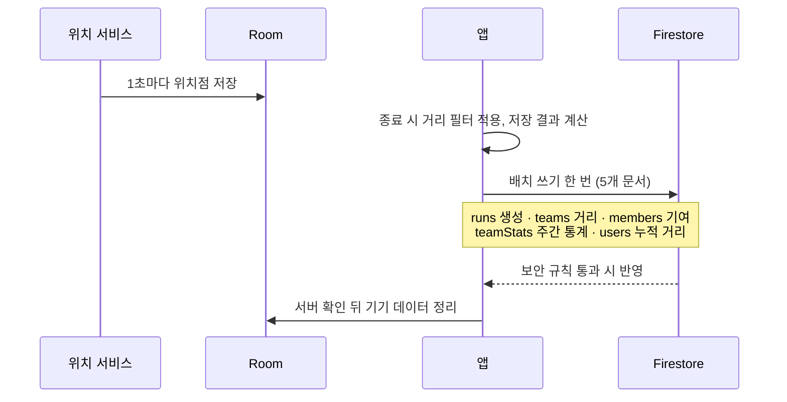

# Tour De Run

팀이 함께 달린 거리를 모아 서울에서 부산까지 350km를 이어 가는 Android 러닝 앱.

혼자 달린 거리가 팀 거리에 더해지고, 팀은 지도 위 7개 스테이지를 차례로 지나며 같은 스테이지의 다른 팀과 경쟁한다.

## 주요 기능

| 기능 | 내용 |
| --- | --- |
| 팀 | 구글 로그인 후 팀(1~4명)을 만들거나 6자리 초대 코드로 참여 |
| 러닝 측정 | GPS로 거리·시간·페이스를 재고, 화면을 꺼도 계속 측정. 강제 종료 후 복구 |
| 여정 | 팀 거리를 서울 → 안양 → 오산 → 천안 → 세종 → 영동 → 대구 → 부산 경로 위 위치로 표시 |
| 스테이지 경쟁 | 같은 스테이지 팀끼리 순위, 바로 앞·뒤 팀과의 거리 차 |
| 주간 통계 | 이번 주 팀 거리와 전체 팀 중 상위 % |
| 도시 도착 | 도시에 도착하면 클리어 연출과 지역 카드 획득 |
| 오프라인 | 연결이 없어도 러닝을 저장하고, 연결되면 서버에 반영 |

## 기술 스택

| 구분 | 사용 |
| --- | --- |
| 언어·UI | Kotlin 2.1, Jetpack Compose, Navigation(타입 안전 라우트) |
| 구조 | MVVM, Hilt, 순수 Kotlin 도메인 모듈 |
| 서버 | Firebase Authentication(구글 로그인, Credential Manager), Cloud Firestore, 보안 규칙 |
| 기기 저장 | Room(측정 중 위치점), DataStore(진행 중 러닝 상태) |
| 위치·지도 | Fused Location Provider, Maps Compose |
| 빌드 | Gradle 8.11.1, AGP 8.7.3, JDK 21(Java 17 타깃), minSdk 26 / targetSdk 35 |
| CI | GitHub Actions: 도메인 테스트, 앱 빌드·테스트·린트, 보안 규칙 테스트 |

## 프로젝트 구조

```
TourDeRun
├── domain/                  순수 Kotlin 모듈. Android·Firebase를 모른다
│   └── com/tourderun/domain
│       ├── model/           공용 모델 (도시, 스테이지, 팀 위치, 러닝 결과 등)
│       ├── route/           경로·스테이지 데이터 (서울 → 부산, 구간 거리)
│       ├── journey/         팀 거리 → 스테이지·진행률·도착 판정
│       ├── race/            스테이지 순위, 앞·뒤 팀, 추월 판정
│       ├── stats/           상위 %, 주차 ID
│       ├── run/             GPS 거리 필터, 페이스, 저장 기준
│       ├── record/          러닝 기록 모델, 저장 결과 계산
│       ├── team/            초대 코드, 참여 가능 판정, 닉네임 검사, 기여 비율
│       └── card/            지역 카드 획득 판정
│
├── app/                     Android 앱
│   └── com/tourderun
│       ├── core/
│       │   ├── data/        Repository (세션, 팀, 러닝, 순위, 통계, 도착, 카드)
│       │   ├── designsystem/  테마, 색·아이콘, 공용 컴포넌트
│       │   ├── navigation/  AppNavHost, 라우트, 하단 탭
│       │   ├── di/          Hilt 모듈
│       │   └── ui/          공용 UI 모델, 실패 화면
│       └── feature/         화면별 ViewModel과 Compose 화면
│           ├── auth/        로그인, 닉네임
│           ├── team/        팀 만들기·참여·정보
│           ├── home/        홈
│           ├── journey/     로드뷰(지도), 스테이지 클리어
│           ├── run/         러닝 측정, 위치 서비스, 결과
│           ├── record/      기록 목록·상세
│           ├── race/        스테이지 순위
│           ├── stat/        주간 통계
│           ├── collection/  지역 도감
│           └── profile/     프로필
│
├── firebase/                Firestore 보안 규칙·인덱스와 규칙 테스트
├── .github/                 CI, 이슈·PR 템플릿
└── scripts/                 저장소 설정 스크립트
```

계산 규칙(스테이지 위치, 순위, 상위 %, 거리 필터 등)은 모두 `domain`의 순수 함수로 두고 단위 테스트로 검증한다. 앱 모듈은 그 결과를 저장하고 보여 주는 일만 한다.

## 서버 구조

직접 운영하는 서버는 없다. 앱이 Firebase에 바로 읽고 쓰며, 서버가 하던 검증은 **Firestore 보안 규칙**이 맡는다.



### Firestore 컬렉션

| 컬렉션 | 문서 | 내용 |
| --- | --- | --- |
| `users` | `{uid}` | 닉네임, 소속 팀, 누적 거리, 러닝 횟수, 지역 카드 |
| `teams` | `{teamId}` | 팀 이름·아이콘·색, 인원, 팀 거리(공개 정보) |
| `teams/{teamId}/members` | `{uid}` | 역할, 기여 거리, 본 도착 수(팀원만 읽음) |
| `inviteCodes` | `{code}` | 초대 코드 → 팀 |
| `runs` | `{runId}` | 러닝 한 번의 거리·시간·경로(본인만 읽음) |
| `teamStats` | `{teamId}_{주차}` | 주간 팀 거리, 러닝 횟수, 팀원별 거리 |

### 러닝 한 번이 저장되는 과정



- 5개 문서는 한 배치라 전부 반영되거나 전부 거부된다. 팀 거리와 기록이 어긋나지 않는다.
- 보안 규칙은 "늘어난 거리가 새 러닝의 거리와 같은지"를 서버에서 확인한다. 앱을 고쳐 거리를 부풀릴 수 없다.
- 오프라인이면 배치가 기기에 대기하다가 연결되면 올라간다. 결과 화면은 서버를 기다리지 않는다.

## 개발 환경 준비

Android Studio에서 Gradle JDK를 **21**로 맞춘다.

저장소에 올리지 않는 파일 두 개를 각자 넣어야 한다.

| 파일 | 내용 | 없으면 |
| --- | --- | --- |
| `app/google-services.json` | Firebase 설정 (권민찬 공유) | Firebase 플러그인이 꺼진 채로 빌드는 되지만, 실행하면 시작할 때 꺼질 수 있다 |
| `local.properties` | `MAPS_API_KEY=발급받은_키` 한 줄 추가 | 기본값 `DUMMY`로 빌드되고, 지도 바탕이 비어 보인다(앱은 꺼지지 않는다) |

- Google Maps 키는 Google Cloud 콘솔에서 **Maps SDK for Android**를 켜고, 앱 제한에 패키지 `com.tourderun`과 자기 디버그 SHA-1(`./gradlew signingReport`)을 넣는다.
- 구글 로그인은 자기 디버그 SHA-1이 Firebase 프로젝트에 등록되어 있어야 된다.
- 지도 화면과 구글 로그인은 Google Play 서비스가 있는 기기·에뮬레이터 이미지(Google Play)에서만 된다.

### 빌드와 테스트

```bash
./gradlew :domain:test                 # 도메인 단위 테스트
./gradlew :app:testDebugUnitTest       # 앱 단위 테스트
./gradlew :app:assembleDebug           # 디버그 APK
./gradlew :app:lintDebug               # 린트
cd firebase && npm ci && npm test      # 보안 규칙 테스트 (Firestore 에뮬레이터)
```

### 에뮬레이터에서 러닝 테스트하기

한국에서는 에뮬레이터의 경로 만들기(Routes)가 되지 않는다. GPX 파일을 가져와 재생한다: Extended Controls → Location → Routes → **Import GPX/KML** → 재생 속도 1x. 러닝은 100m 이상, 1분 이상이어야 저장되고, 종료 버튼은 길게 누른다.

## 협업 규칙

- **브랜치:** GitHub Flow. `main`에서 `<type>/<기능ID>-<설명>` 브랜치를 만든다. 예: `feat/RUN-04-tracking-service`
- **커밋·PR 제목:** `<type>(<기능ID>): 한국어 요약`. 예: `feat(REC-01): 러닝 저장 배치 추가`
- **머지:** 리뷰 1명 승인과 CI 통과 후 Squash merge. `main`에 직접 push하지 않는다.
- **소유:** 다른 사람이 맡은 코드를 고칠 때는 최소로 고치고 그 사람을 리뷰어로 지정한다.
- **보안:** `google-services.json`, `local.properties`, 키 파일은 커밋하지 않는다. 보안 규칙·인덱스 배포는 담당자만 한다.

## 팀

| 이름 | GitHub | 맡은 부분 |
| --- | --- | --- |
| 권민찬 | [@tronve](https://github.com/tronve) | 로그인·팀, Firebase(보안 규칙·인덱스), 팀장 |
| 오영훈 | [@oyeonghun](https://github.com/oyeonghun) | 여정·경쟁·통계 엔진, 러닝 저장, GitHub 관리 |
| 전병국 | [@jeonbinggu](https://github.com/jeonbinggu) | 홈·지도·기록 화면, 디자인 시스템, QA·시연 |
| 최한솔 | [@sol7722](https://github.com/sol7722) | 러닝 측정(위치 서비스·복구), 디자인·발표 |
